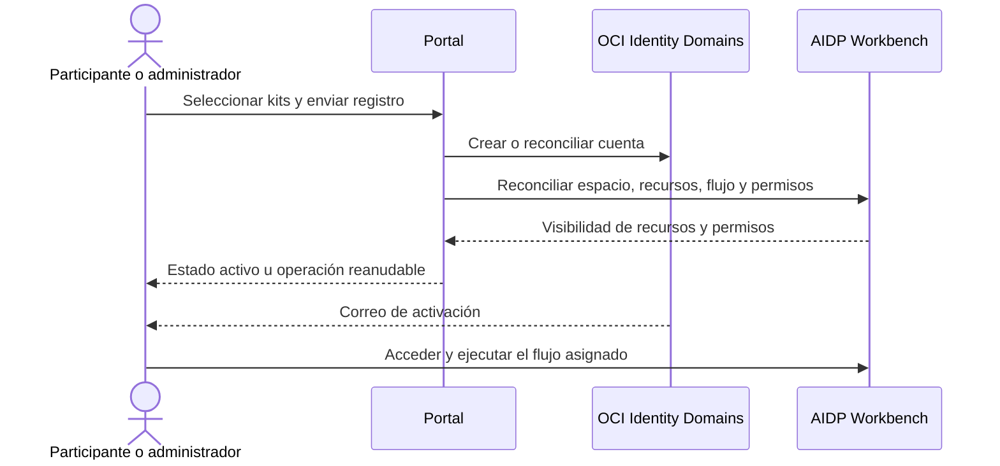

# Primeros pasos

[Documentación](README.md) · [Operaciones](operations.md) · [Contratos vigentes](contracts.md)

Esta guía describe el despliegue compartido y el acceso de participantes. Para ejecutar el portal en Docker, consulte [Desarrollo y validación](development.md). Compruebe el contrato del paquete seleccionado y la aceptación de su instalación antes de ejecutar un laboratorio: una etiqueta o pruebas unitarias correctas no demuestran que funcione en OCI/AIDP.

## Límites de la implementación

| Área | Comportamiento del código y limitación |
| --- | --- |
| Rutas de participantes | El aprovisionador entrega `/Workspace/<lab_id>/<participant_key>_<email>` y el catálogo `oci_medallion`. Los notebooks incluidos en los paquetes `2.0.0` aún validan `/Workspace/medallon/` y `<participant_key>_aidp`. Las ejecuciones nuevas pueden fallar en esas comprobaciones antes de ingerir datos. Es necesario reconciliar y aceptar este contrato antes de considerar listos los trabajos de participantes. |
| Telco Customer 360 | La aceptación del paquete `2.0.0` requiere ejecutar las aserciones de sus notebooks y comprobar sus resultados en la instalación del participante. No se certifica mediante pruebas de otra versión. |

La discrepancia de rutas puede comprobarse en las [funciones de nombres](../apps/backend/app/kits/naming.py), el [aprovisionamiento de trabajos](../apps/backend/app/services/oci/aidp.py) y el [notebook de Banking](../apps/backend/app/kits/banking/notebooks/01_landing_banking.ipynb). No omita las comprobaciones del notebook ni use el catálogo de otro participante para aparentar una ejecución correcta.

## Desplegar un entorno compartido

Use el [paquete de Deploy Studio](../terraform/deploy-studio.json) de una [versión inmutable](https://github.com/jgangini/oci-ai-data-platform-workbench-starter-kits/releases) validada. Necesita un perfil de operador OCI, una clave API RSA, un compartimento de destino y permisos para los recursos declarados en Terraform. Entregue las credenciales por la carga protegida de Deploy Studio; no las añada al repositorio ni a las fuentes o al estado de Terraform. Seleccione una región suscrita compatible con AIDP.

1. Seleccione un compartimento nuevo o existente e indique las credenciales del administrador y el código de registro del laboratorio.
2. Seleccione o cree los cuatro buckets de medallón y otro de artefactos, cuyo nombre predeterminado es `oci_artifacts`. Los cinco deben ser distintos; los existentes deben pertenecer al compartimento seleccionado.
3. En **AI Data Platform Workbench**, elija **Services mode**. Para crear, el nombre inicial es `aidp_medallion`; para reutilizar, seleccione una plataforma ACTIVE y STRUCTURED del compartimento y región elegidos. No se solicita Autonomous ni un modelo de Agent Flow.
4. Despliegue el portal de kits con HTTPS automático. Los módulos se instalan desde Deploy Studio usando sus repositorios independientes.
5. Revise las fases de comprobación previa, plan, aplicación y comprobación posterior. Un `terraform apply` correcto no certifica espacios de trabajo, flujos ni participantes.
6. Conserve el resumen protegido de acceso y las salidas `application_url`, `admin_url` y `aidp_workbench_url`.

Starter Kits funciona exclusivamente como laboratorio. No hay selector de modo de despliegue. El código de registro es obligatorio y Deploy Studio entrega a Terraform únicamente su verificador PBKDF2. El administrador puede cambiarlo en Settings sin exponer el código guardado.

El [manifiesto de despliegue](../terraform/deploy-studio.json) define el formulario y el contrato de descubrimiento; [`l_outputs.tf`](../terraform/l_outputs.tf) define los endpoints y nombres de buckets resueltos.

## Registrar y activar un participante

1. Abra la URL de la aplicación e indique nombre, correo, código de registro y uno o más kits. El administrador también puede usar **Users → Add user**.
2. Espere las fases de identidad, espacio de trabajo, contenido y permisos. Si se ofrece un reintento, continúe la misma operación.
3. Active la cuenta OCI Identity Domains desde su correo de bienvenida estándar.
4. Acceda a AIDP Workbench con ese correo y la URL suministrada.

## Ejecutar un kit

Cuando el contrato de rutas de la versión haya superado su aceptación:

1. Abra la carpeta del kit del participante y revise `lab-manifest.json`, los archivos `source/` y los notebooks.
2. Abra `wf_<participant_key>_<lab_id>` y confirme que el cómputo compartido esté disponible.
3. Ejecute el flujo y revise las salidas de cada tarea, incluidas calidad y linaje.
4. Compare los resultados con la guía del kit y el `lab.json` del paquete instalado.
5. Abra las tablas Gold del participante en Master Catalog y revise el linaje de entidades y columnas hacia las capas anteriores.

| Recurso | Convención del aprovisionador actual |
| --- | --- |
| Clave de participante | `u101`, `u102`, … |
| Espacio de trabajo | `/Workspace/<lab_id>/<participant_key>_<normalized_email>` |
| Archivos de entrada | `<workspace>/source/` |
| Flujo | `wf_<participant_key>_<lab_id>` |
| Catálogo y esquemas | `oci_medallion.oci_landing`, `oci_bronze`, `oci_silver`, `oci_gold` |
| Tabla | `<participant_key>_<lab_id>_<logical_table>`; no se duplica un prefijo de kit ya presente |

El flujo suministra `participant_key`, `lab_id`, `workspace_root`, `bucket_name`, `objectstorage_namespace` y `catalog_name`. No edite los CSV para incorporar valores personales. El catálogo determina las ubicaciones de tablas administradas; una función de rutas del notebook no demuestra por sí sola dónde se escriben los datos.

## Elegir el siguiente ejercicio

Para una canalización de medallón de cinco tareas, use [Banking](kits/banking.md), [Telecommunications](kits/telecommunications.md), [Retail](kits/retail.md) o [Healthcare](kits/healthcare.md). [Telco Customer 360 Lineage](kits/telco-lineage.md) incluye ramificación y convergencia en 14 tareas.

Los [módulos independientes](README.md#módulos-independientes) tienen sus propias guías de instalación. Este paquete solo administra kits: no debe aplicarse sobre una pila combinada ni usarse para convertirla mediante una actualización del portal.

El compute compartido de Spark mantiene un driver de 2 OCPU/32 GiB y workers de 2 OCPU/32 GiB, con un mínimo de 1 y máximo de 10 workers. La VM del portal conserva 2 OCPU/16 GiB. La capacidad efectiva se valida durante el despliegue; no se reservan recursos con una comprobación previa.

Al reutilizar AIDP, use su compartimento existente. Si ya contiene recursos con los nombres reservados de Kits que pertenecen a otro despliegue, la instalación se detiene antes de modificar sus permisos. Consulte el contrato de propiedad y recuperación en [Contratos](contracts.md).
