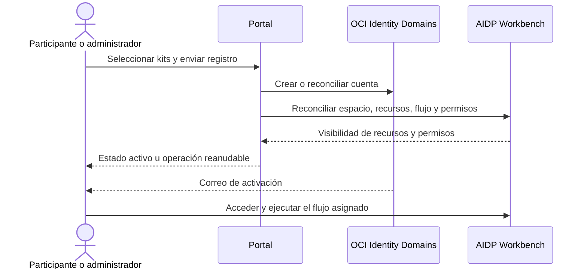

# Primeros pasos

[Documentación](README.md) · [Operaciones](operations.md) · [Contratos vigentes](contracts.md)

Esta guía describe el despliegue compartido y el acceso de participantes. Para ejecutar el portal en Docker, consulte [Desarrollo y validación](development.md). Compruebe el contrato del paquete seleccionado y la aceptación de su instalación antes de ejecutar un laboratorio: una etiqueta o pruebas unitarias correctas no demuestran que funcione en OCI/AIDP.

## Límites de la implementación

| Área | Comportamiento del código y limitación |
| --- | --- |
| Rutas de participantes | Los cinco paquetes `2.0.1` aceptan la ruta `/Workspace/<lab_id>/<participant_key>_<email_codificado>` y el catálogo privado `oci_medallion_<participant_key>` que entrega el aprovisionador. La prueba local verifica esos parámetros en cada notebook. La ejecución de Spark y los permisos se comprueban en Workbench. |
| Telco Customer 360 | La aceptación del paquete `2.0.1` requiere ejecutar las aserciones y comprobar el linaje en la instalación del participante. |

Para actualizar una asignación activa de `2.0.0`, el instructor usa **Users → Manage starter kits → Update kit**. La operación vuelve a crear el workflow, elimina las tablas y los objetos generados y reemplaza los notebooks y los archivos fuente incluidos en ese kit. Conserva los demás kits y el acceso de Identity Domains. Verifique cada ejecución según la [aceptación en Workbench](testing.md#aceptación-en-workbench).

## Desplegar un entorno compartido

Use el [paquete de Deploy Studio](../terraform/deploy-studio.json) de una [versión inmutable](https://github.com/jgangini/oci-ai-data-platform-workbench-starter-kits/releases) validada. Necesita un perfil de operador OCI, una clave API RSA, un compartimento de destino y permisos para los recursos declarados en Terraform. Entregue las credenciales por la carga protegida de Deploy Studio; no las añada al repositorio ni a las fuentes o al estado de Terraform. Seleccione una región suscrita compatible con AIDP.

1. Abra [Deploy Studio](https://cloudtechnext.net/#deploy), seleccione la release de Starter Kits, adjunte el perfil OCI y su clave API y elija un compartimento.
2. En **AI Data Platform Workbench**, elija **Services mode**. Para crear, el nombre inicial es `aidp_medallion`. Para reutilizar, seleccione una plataforma ACTIVE y STRUCTURED y su **Existing workspace**.
3. En **Medallion Architecture**, seleccione o cree cuatro buckets distintos para Landing, Bronze, Silver y Gold. Confirme las sugerencias del formulario. En **Application VM**, configure el administrador y el código de registro.
4. Despliegue el portal de kits con HTTPS automático. Los módulos se instalan desde Deploy Studio usando sus repositorios independientes.
5. Revise las fases de comprobación previa, plan, aplicación y comprobación posterior. Un `terraform apply` correcto no certifica espacios de trabajo, flujos ni participantes.
6. Consulte el correo de acceso o el resumen protegido de Deploy Studio. Conserve en privado las salidas de acceso.

Starter Kits funciona exclusivamente como laboratorio. No hay selector de modo de despliegue. El código de registro es obligatorio y Deploy Studio entrega a Terraform únicamente su verificador PBKDF2. El administrador puede cambiarlo en Settings sin exponer el código guardado.

El [manifiesto de despliegue](../terraform/deploy-studio.json) define el formulario y el contrato de descubrimiento; [`l_outputs.tf`](../terraform/l_outputs.tf) define los endpoints y nombres de buckets resueltos.

## Correo y accesos del despliegue

El correo de éxito se dirige al operador y reúne dos secciones de acceso.

| Servicio | Contenido |
| --- | --- |
| Starter Kits Portal | URL de inicio de sesión, usuario y contraseña del administrador. Incluye el código de registro cuando está disponible para el correo. |
| Oracle AI Data Platform Workbench | URL, nombre del workspace y autenticación mediante el dominio de identidad configurado. |

El correo adjunta `terraform-source.zip`, `deployment.log` con secretos redactados y `vm-ssh-access.zip` con la clave de la VM y su guía. El paquete Terraform excluye los archivos de credenciales OCI. Trata el correo y el ZIP de SSH como material privado. Los participantes activan su identidad OCI mediante un correo de bienvenida separado.

## Registrar y activar un participante

1. Abra la URL de la aplicación, indique nombre, correo, código de registro y uno o más kits, y pulse **Create account**. El administrador también puede usar **Users → Add user**.
2. Espere las fases de identidad, espacio de trabajo, contenido y permisos. Si se ofrece un reintento, continúe la misma operación.
3. Si OCI Identity Domains solicita activar la cuenta, siga el enlace de su correo de bienvenida.
4. Al aparecer **Your starter kit account is ready**, seleccione **Open AI Data Platform Workbench** e inicie sesión con su identidad OCI.

## Ejecutar un kit

Cuando el contrato de rutas de la versión haya superado su aceptación:

1. Abra la carpeta del kit del participante y revise `lab-manifest.json`, los archivos `source/` y los notebooks.
2. Abra `wf_<participant_key>_<lab_id>` y confirme que el cómputo compartido esté disponible.
3. Ejecute el flujo y revise las salidas de cada tarea, incluidas calidad y linaje.
4. Compare los resultados con la guía del kit y el `lab.json` del paquete instalado.
5. Abra las tablas Gold del participante en Master Catalog y revise el linaje de entidades y columnas hacia las capas anteriores.

| Recurso | Convención del aprovisionador actual |
| --- | --- |
| Clave de participante | `u101`, `u102`, … |
| Espacio de trabajo | `/Workspace/<lab_id>/<participant_key>_<normalized_email>` |
| Archivos de entrada | `<workspace>/source/` |
| Flujo | `wf_<participant_key>_<lab_id>` |
| Catálogo y esquemas | `oci_medallion_<participant_key>.oci_landing`, `oci_bronze`, `oci_silver`, `oci_gold` |
| Tabla | `<participant_key>_<lab_id>_<logical_table>`; no se duplica un prefijo de kit ya presente |

El flujo suministra `participant_key`, `lab_id`, `workspace_root`, `bucket_name`, `objectstorage_namespace` y `catalog_name`. No edite los CSV para incorporar valores personales. El catálogo determina la ubicación de las tablas administradas. El workflow se configura con el participante como identidad de ejecución. En Workbench, verifica que tu usuario figure en **Run As** y consulta tus resultados dentro de tu catálogo.

## Elegir el siguiente ejercicio

Para una canalización de medallón de cinco tareas, use [Banking](kits/banking.md), [Telecommunications](kits/telecommunications.md), [Retail](kits/retail.md) o [Healthcare](kits/healthcare.md). [Telco Customer 360 Lineage](kits/telco-lineage.md) incluye ramificación y convergencia en 14 tareas.

Los [módulos independientes](README.md#módulos-independientes) tienen sus propias guías de instalación. Este paquete solo administra kits: no debe aplicarse sobre una pila combinada ni usarse para convertirla mediante una actualización del portal.

El compute compartido de Spark mantiene un driver de 2 OCPU/32 GiB y workers de 2 OCPU/32 GiB, con un mínimo de 1 y máximo de 10 workers. La VM del portal conserva 2 OCPU/16 GiB. La capacidad efectiva se valida durante el despliegue; no se reservan recursos con una comprobación previa.

Al reutilizar AIDP, use su compartimento existente. Si ya contiene recursos con los nombres reservados de Kits que pertenecen a otro despliegue, la instalación se detiene antes de modificar sus permisos. Consulte el contrato de propiedad y recuperación en [Contratos](contracts.md).

## Workspace de una plataforma existente

Al elegir **Use existing AIDP**, seleccione la plataforma y luego **Existing workspace**. La lista depende de esa plataforma y de los permisos del operador OCI. La selección debe estar ACTIVE; se comprueba de nuevo al desplegar. El portal identifica el workspace por su clave y mantiene carpetas y permisos separados por participante y kit dentro de ese workspace compartido. No crea un workspace AIDP por participante. Con **Create new AIDP**, se usa automáticamente el workspace predeterminado de la plataforma nueva.
