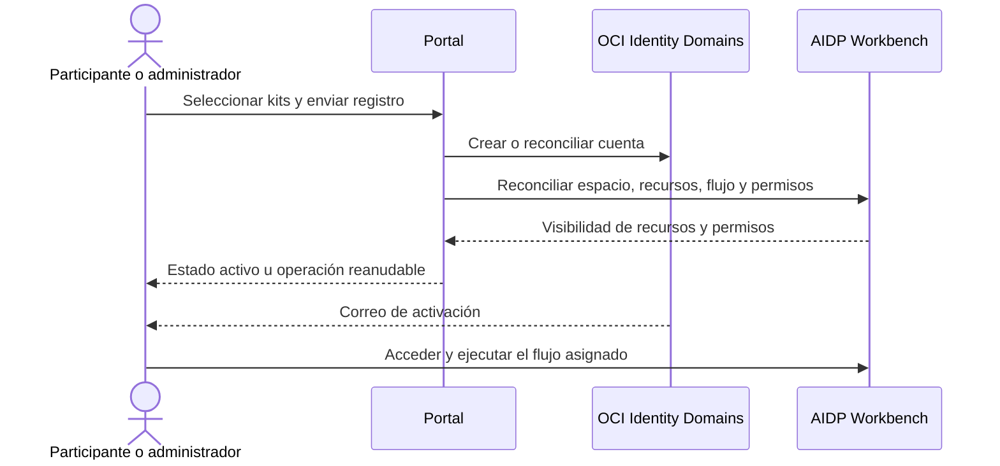

# Primeros pasos

[Documentación](README.md) · [Operaciones](operations.md) · [Contratos vigentes](contracts.md)

Esta guía describe el despliegue compartido y el acceso de participantes. Para ejecutar el portal en Docker, consulte [Desarrollo y validación](development.md). Compruebe el contrato del paquete seleccionado y la aceptación de su instalación antes de ejecutar un laboratorio: una etiqueta o pruebas unitarias correctas no demuestran que funcione en OCI/AIDP.

## Límites de la implementación

| Área | Comportamiento del código y limitación |
| --- | --- |
| Rutas de participantes | El aprovisionador entrega `/Workspace/<lab_id>/<participant_key>_<email>` y el catálogo `oci_medallion`. Los notebooks incluidos en los paquetes `2.0.0` aún validan `/Workspace/medallon/` y `<participant_key>_aidp`. Las ejecuciones nuevas pueden fallar en esas comprobaciones antes de ingerir datos. Es necesario reconciliar y aceptar este contrato antes de considerar listos los trabajos de participantes. |
| Contratos de AI God’s Eye View | Esta versión exige sesiones, configuración, recibos y controles Object actuales. No adopta ni migra formatos de instalaciones anteriores. La disponibilidad de fuentes no acredita aceptación nativa; consulte los [contratos vigentes](contracts.md). |
| Instalación desde el portal | Las bases nuevas reservan la red de módulos y registran la pila Resource Manager original. Una base existente sin ese registro o topología no adquiere esta capacidad con una actualización de la imagen. Los planes simulados y las pruebas locales no acreditan una instalación real. |
| Evidencia de Telco Customer 360 | El informe de validación disponible corresponde al paquete `1.1.2`; no certifica el paquete actual `2.0.0` ni una instalación nueva. |

La discrepancia de rutas puede comprobarse en las [funciones de nombres](../apps/backend/app/kits/naming.py), el [aprovisionamiento de trabajos](../apps/backend/app/services/oci/aidp.py) y el [notebook de Banking](../apps/backend/app/kits/banking/notebooks/01_landing_banking.ipynb). No omita las comprobaciones del notebook ni use el catálogo de otro participante para aparentar una ejecución correcta.

## Desplegar un entorno compartido

Use el [paquete de Deploy Studio](../terraform/deploy-studio.json) de una [versión inmutable](https://github.com/jgangini/oci-ai-data-platform-workbench-starter-kits/releases) validada. Necesita un perfil de operador OCI, una clave API RSA, un compartimento de destino y permisos para los recursos declarados en Terraform. Entregue las credenciales por la carga protegida de Deploy Studio; no las añada al repositorio ni a las fuentes o al estado de Terraform. Seleccione una región suscrita con las capacidades AIDP, base de datos y modelo de chat que ofrece el formulario.

1. Seleccione un compartimento nuevo o existente y el modo de despliegue.
2. Seleccione o cree los cuatro buckets de medallón y otro de artefactos de Governance, cuyo nombre predeterminado es `oci_artifacts`. Los cinco deben ser distintos; los existentes deben pertenecer al compartimento seleccionado.
3. Elija la base de datos y el modelo regional ofrecidos. La plataforma mantiene Autonomous para sus contratos actuales.
4. Despliegue el portal central. La base prepara la red privada compartida y HTTPS automático con IP pública y mantiene cerrado SSH público. Governance, Market Intelligence y God's Eye View se instalan después desde Settings → Application, con sus respectivos controles de aceptación.
5. Revise las fases de comprobación previa, plan, aplicación y comprobación posterior. Un `terraform apply` correcto no certifica espacios de trabajo, modelos, flujos ni participantes.
6. Conserve el resumen protegido de acceso y las salidas `application_url`, `admin_url` y `aidp_workbench_url`.

| Modo del formulario | Registro |
| --- | --- |
| `Laboratory` | Los participantes pueden registrarse con el código del instructor; los administradores también pueden crear usuarios. |
| `Production` | El registro público está deshabilitado; los administradores crean participantes desde Users. |

El [manifiesto de despliegue](../terraform/deploy-studio.json) define el formulario y el contrato de descubrimiento; [`l_outputs.tf`](../terraform/l_outputs.tf) define los endpoints y nombres de buckets resueltos.

Para añadir AI God's Eye View, abra **Settings → Application → Install**, revise y confirme los recursos de su VM privada y cómputo AIDP y siga las fases de instalación. El portal aplica un plan restringido en la pila original e inicializa sus flujos y agente. Cerrar el diálogo no cancela la instalación. Consulte el [ciclo de vida de módulos](operations.md#global-module-lifecycle) para reintentos, aceptación y requisitos vigentes. AI Data Governance conserva su flujo separado de instalación con administrador seleccionado.

## Registrar y activar un participante

1. Abra la URL de la aplicación. En modo `Laboratory`, indique nombre, correo, código de registro y uno o más kits. En modo `Production`, use **Users → Add user** con una cuenta administradora.
2. Espere las fases de identidad, espacio de trabajo, contenido y permisos. Si se ofrece un reintento, continúe la misma operación.
3. Active la cuenta OCI Identity Domains desde su correo de bienvenida estándar.
4. Acceda a AIDP Workbench con ese correo y la URL suministrada.

Cuando la instalación compartida esté lista, los administradores pueden seleccionar únicamente AI God's Eye View en **Users → Add user**. Estos lectores activan su cuenta OCI Identity Domains y usan **Sign in with OCI** en `/gods-eye-view/`; no se crea un espacio de trabajo de participante. El acceso de lectores existentes se administra desde **Manage starter kits**. Consulte la [guía del módulo](modules/ai-gods-eye-view.md).

## Ejecutar un kit

Cuando el contrato de rutas de la versión haya superado su aceptación:

1. Abra la carpeta del kit del participante y revise `lab-manifest.json`, los archivos `source/` y los notebooks.
2. Abra `wf_<participant_key>_<lab_id>` y confirme que el cómputo compartido esté disponible.
3. Ejecute el flujo y revise las salidas de cada tarea, incluidas calidad y linaje.
4. Compare los resultados con la guía del kit y el `lab.json` del paquete instalado.
5. Abra las tablas Gold del participante en Master Catalog y revise el linaje de entidades y columnas hacia las capas anteriores.

| Recurso | Convención del aprovisionador actual |
| --- | --- |
| Clave de participante | `u101`, `u102`, … |
| Espacio de trabajo | `/Workspace/<lab_id>/<participant_key>_<normalized_email>` |
| Archivos de entrada | `<workspace>/source/` |
| Flujo | `wf_<participant_key>_<lab_id>` |
| Catálogo y esquemas | `oci_medallion.oci_landing`, `oci_bronze`, `oci_silver`, `oci_gold` |
| Tabla | `<participant_key>_<lab_id>_<logical_table>`; no se duplica un prefijo de kit ya presente |

El flujo suministra `participant_key`, `lab_id`, `workspace_root`, `bucket_name`, `objectstorage_namespace` y `catalog_name`. No edite los CSV para incorporar valores personales. El catálogo determina las ubicaciones de tablas administradas; una función de rutas del notebook no demuestra por sí sola dónde se escriben los datos.

## Elegir el siguiente ejercicio

Para una canalización de medallón de cinco tareas, use [Banking](kits/banking.md), [Telecommunications](kits/telecommunications.md), [Retail](kits/retail.md) o [Healthcare](kits/healthcare.md). [Telco Customer 360 Lineage](kits/telco-lineage.md) incluye ramificación y convergencia en 14 tareas.

Consulte [AI Data Governance](modules/ai-data-governance.md), [AI Market Intelligence](modules/ai-market-intelligence.md) y [AI God's Eye View](modules/ai-gods-eye-view.md) para conocer su disponibilidad, controles de **Settings → Application** y aceptación pendiente. Son módulos compartidos; su instalación no equivale a asignar un kit a un participante.
