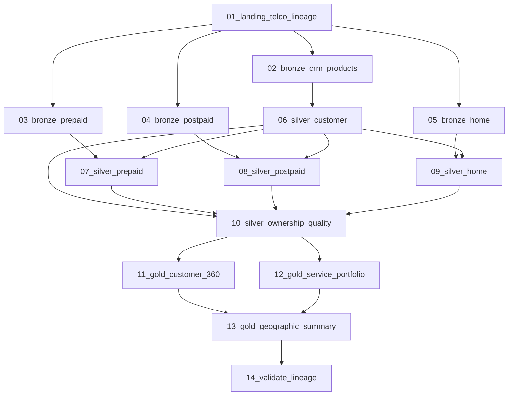

# Telco Customer 360 Lineage

[Documentación](../README.md) · [Primeros pasos](../getting-started.md)

El [paquete `2.0.0`](../../apps/backend/app/kits/telco_lineage/lab.json) unifica identidad y titularidad de servicios prepago, pospago y hogar con un flujo ramificado y validaciones exactas de calidad y linaje. Es distinto del [laboratorio de consumo Telecommunications](telecommunications.md). Antes de ejecutarlo, revise la [incompatibilidad actual entre notebooks y aprovisionador](../getting-started.md#current-implementation-limits).

## Entradas y flujo

Los [diez CSV de entrenamiento](../../apps/backend/app/kits/telco_lineage/source) contienen **7,405 filas**; no son conectores CRM ni de facturación reales.

| CSV | Filas | Contenido |
| --- | ---: | --- |
| `crm_customers.csv` | 500 | Identidad de clientes |
| `crm_addresses.csv` | 620 | Direcciones |
| `product_catalog.csv` | 15 | Productos compartidos |
| `prepaid_lines.csv` | 650 | Titularidad prepago |
| `prepaid_recharges.csv` | 3,000 | Importes de recargas |
| `postpaid_accounts.csv` | 280 | Cuentas de facturación |
| `postpaid_lines.csv` | 400 | Servicios pospago |
| `postpaid_invoices.csv` | 1,500 | Facturas |
| `home_services.csv` | 220 | Titularidad de servicios hogar |
| `home_installations.csv` | 220 | Instalaciones y direcciones |

Las sumas originales son **44,910.00** en recargas, **106,800.30** en facturas y **589.00** en mensualidades del catálogo. Reconcilian entradas distintas; no son totales Gold intercambiables.

El trabajo `wf_<participant_key>_telco_lineage` ejecuta estas dependencias de los [14 notebooks](../../apps/backend/app/kits/telco_lineage/notebooks):

Landing y Bronze preservan cada origen; Silver resuelve identidad, direcciones, productos y titularidad antes de Gold. El contrato declara **31 tablas Delta administradas**: 10 Landing, 10 Bronze, 8 Silver y 3 Gold. `quality_issues` recibe los rechazos de validación.

## Resultados y aceptación

Las tablas Gold siguen `<catalog_name>.oci_gold.<participant_key>_telco_lineage_<nombre>`.

| Nombre Gold | Filas | Contenido |
| --- | ---: | --- |
| `customer_360` | 493 | Identidad, dirección principal, servicios y valor mensual por cliente |
| `customer_service_portfolio` | 1,261 | Servicio, producto, cliente y ubicación |
| `geographic_service_summary` | 12 | Clientes, servicios y valor mensual por región, provincia y ciudad |

El [notebook de validación](../../apps/backend/app/kits/telco_lineage/notebooks/14_validate_lineage.ipynb) exige 493 clientes, 617 direcciones, 15 productos y 1,261 titularidades en Silver; 645 servicios prepago, 398 pospago y 218 hogar; exactamente **30** filas en `quality_issues`; tablas Delta administradas con historial fuera de Landing; y totales mensuales de las tres salidas Gold conciliados con tolerancia de 0.01.

Revise el linaje de entidad y columna en ambas direcciones con profundidad 8. Siga `prepaid_recharges.amount` por la titularidad hasta el valor mensual de cliente y geografía. Confirme los esquemas `oci_landing`, `oci_bronze`, `oci_silver` y `oci_gold`: el manifiesto rechaza nodos antiguos `aidp_lab.telco_lineage.*`.

## Ejecución del participante

Siga [Primeros pasos](../getting-started.md), conserve los parámetros de su flujo y ejecute el grafo completo respetando las dependencias. Revise los conteos exactos y el linaje de cada ancla Gold. Repita con entradas idénticas y confirme los conteos y la conciliación mensual. Use el catálogo desplegado y su prefijo de participante.

El [informe histórico de validación](../../apps/backend/app/kits/telco_lineage/VALIDATION.md) corresponde a `1.1.2` y explica la relevancia de las tablas administradas. Sus conteos de grafo y formato Landing no certifican `2.0.0`; la aceptación actual requiere el manifiesto, las aserciones ejecutables y una ejecución nativa verificada.
